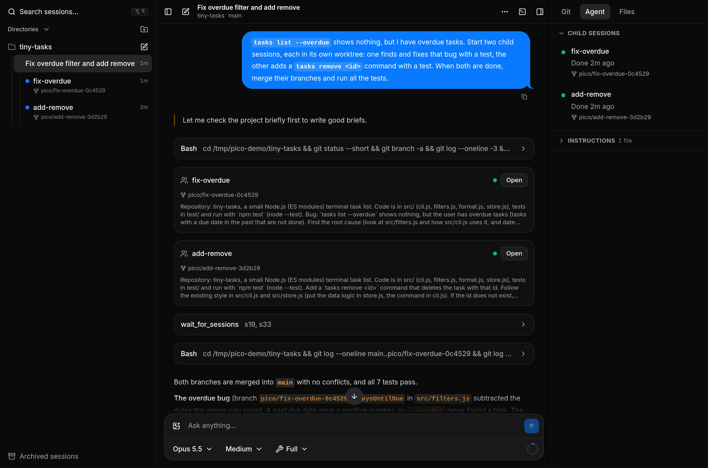
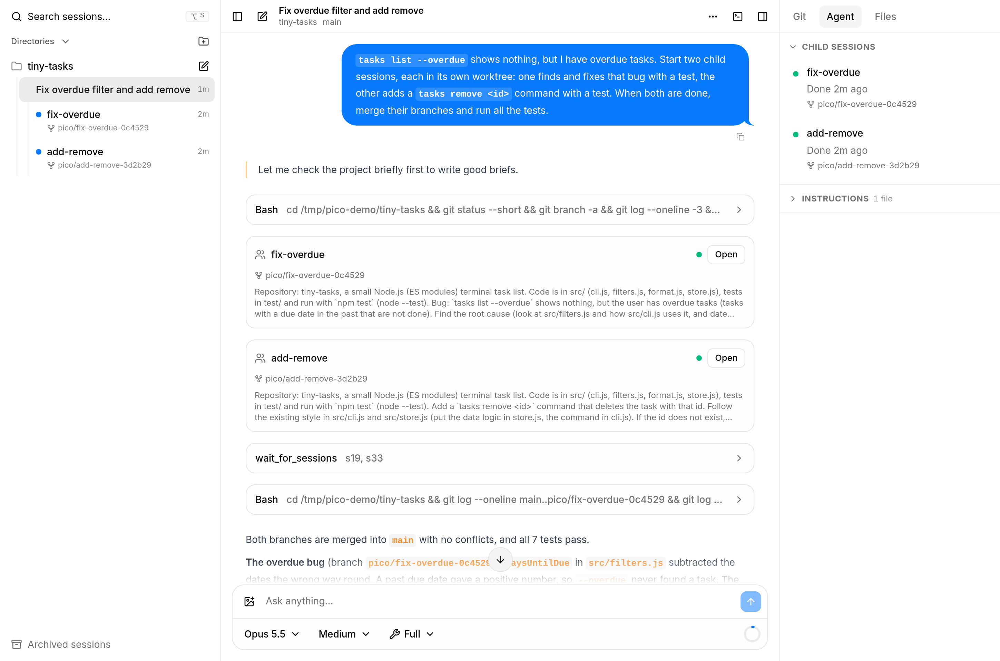
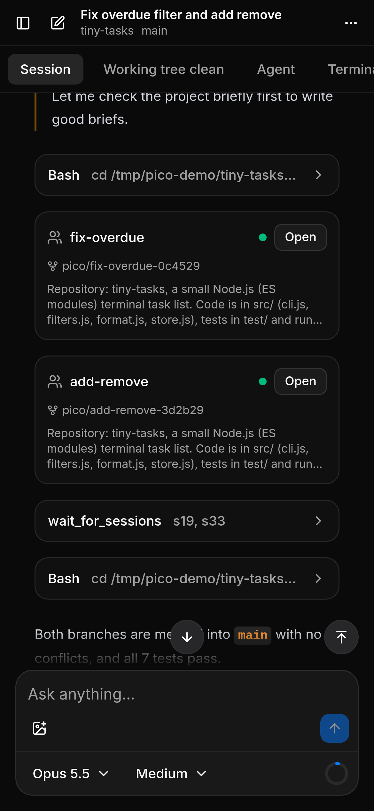
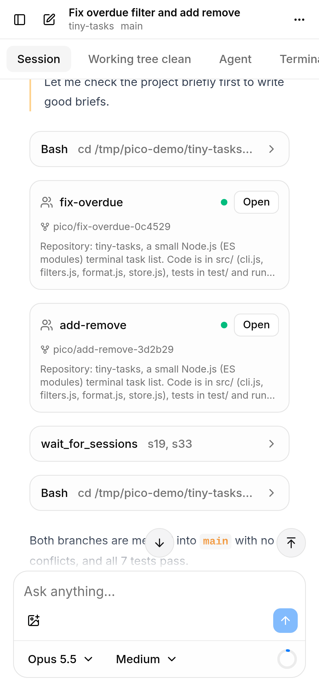

# Pico

A web workspace for durable [Pi](https://www.npmjs.com/package/@earendil-works/pi-durable)
coding-agent sessions. One Node server hosts the agent runtime and serves the
React web app.





| Dark mobile browser                                                               | Light mobile browser                                                                   |
| --------------------------------------------------------------------------------- | -------------------------------------------------------------------------------------- |
|  |  |

## Requirements

- Node.js 22.19 or later
- pnpm 10.33 (only to run from source)
- Git and a shell
- Provider credentials in `~/.pi/agent/auth.json`, or set them in Pico

## Install

```sh
npm install -g @alivault/pico
pico-app
```

Or try it without a global install: `npx @alivault/pico`.

## Run from source

```sh
pnpm install
pnpm build
pnpm start
```

Open `http://127.0.0.1:3141`. Useful commands:

```sh
pnpm start --no-open --port 3141
pnpm start --data-dir PATH   # default: ~/.pico
pnpm start status
pnpm start stop --wait       # let active runs finish first
pnpm start import-pi         # import old Pi sessions (stop Pico first)
```

## What it does

- **Durable sessions.** Sessions live in one SQLite database. Runs continue
  after a crash or restart. Tools with side effects do not run twice.
- **Workspace.** Git changes and diffs, file browser, syntax highlighting, and
  terminals.
- **Agent tools.** Todo lists, questions to the user, rich output (charts,
  diagrams, tables), timers and watches, background jobs, child sessions in
  git worktrees, Git and GitHub, LSP, browser automation, app previews, web
  access, and MCP.
- **Tool profiles.** `full`, `research`, `read-only`, `review`, or your own.
- **Notifications.** Web Push and ntfy when a run finishes or the agent asks
  a question.

Pi skills, prompt templates, project instructions, and credentials are used.
Legacy Pi extensions are not loaded.

## Remote access

Pico has no login. Anyone who can reach it can run commands as your user.
Use Tailscale and never expose it to the public internet.

```sh
pnpm start --host <tailscale-ip> --no-open
```

Use Tailscale Serve for HTTPS (needed for push notifications).

## Multiple machines

One Pico can show the sessions of other computers, for example a build
server. Each machine runs its own Pico on its `127.0.0.1`. The Pico that you
open (the hub) connects to them over SSH and shows them in the sidebar.
Sessions, terminals, and jobs run on their own machine and continue when the
hub goes offline.

```sh
pico-app machine add ali@workbox      # SSH target, alias, or Tailscale name
pico-app machine list
pico-app machine reconnect workbox    # after a password, key, or check prompt
pico-app machine remove workbox       # Pico keeps running on workbox
```

`machine add` connects in your terminal, so SSH can ask for a password or a
host key. It finds Node.js 22.19+ and Pico on the remote machine, and asks
before it installs Pico (with npm, into `~/.local`). The hub then uses your
SSH config, keys, and agent with one shared connection. It never asks for
input; when SSH needs you, the machine shows **Attention** and the command to
run. Pico does not store passwords or keys, and it copies no settings or
credentials to other machines.

Tailscale works: use a MagicDNS name or a `100.x` address as the target,
with OpenSSH or Tailscale SSH.

Anyone who can open the hub can run commands on all its machines. Keep the
hub on localhost or your tailnet. Agents on the hub can use the session tools
with a `machine` argument, for example to start a session on `workbox`.

## Development

```sh
pnpm dev     # backend on 3141, Vite client on 3142
pnpm check
pnpm build
```

This is a pnpm monorepo:

- `apps/pico`: the Pico app. Client code is in `apps/pico/src`. Server code
  is in `apps/pico/server/src`.
- `apps/website`: the static site at
  [pico.aliabbas.net](https://pico.aliabbas.net). Deploy it with
  `pnpm website:deploy`.

## License

AGPL-3.0-only. See [LICENSE](LICENSE).
