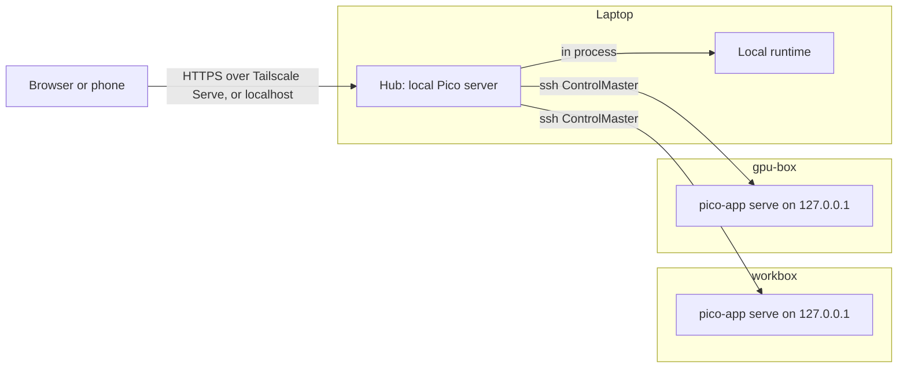
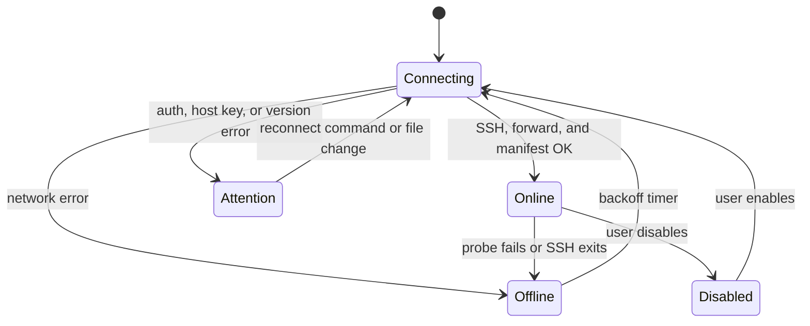

# Design: Multiple machines in one Pico

Status: implemented (version 1). See [Implementation notes](#implementation-notes).

## Goal

One Pico window shows sessions from more than one machine. For example, a laptop
and a build server. You can read, prompt, and control sessions, terminals, git,
and previews on each machine. The sidebar shows all machines and the status of
their sessions.

## Requirements

1. **SSH is the transport.** It works on all hosts that have `sshd`. Pico uses
   the user's OpenSSH config, keys, and agent. Pico does not store passwords
   or keys.
2. **It must work over Tailscale.** An SSH target can be a Tailscale MagicDNS
   name (`workbox`, `workbox.tail1234.ts.net`) or a tailnet IP. The target can
   use OpenSSH `sshd` or Tailscale SSH. The phone keeps its access to the hub
   through Tailscale Serve, as it does now.
3. **Each machine keeps its own Pico server.** Sessions, terminals, jobs, and
   timers run on the machine that owns them. A lost connection does not stop
   them.
4. **One machine must not block another.** A slow or offline machine has no
   effect on the other machines or on the local machine.
5. **No secrets go to other hosts.** Each machine keeps its own `auth.json`,
   settings, profiles, and MCP config. Pico does not copy them.

## Non-goals (for now)

- Windows hosts (OpenSSH on Windows has no ControlMaster).
- Direct HTTP from the hub to a remote Pico over the tailnet. SSH covers
  Tailscale, so one transport is enough. The design keeps a transport interface
  so that we can add this later.
- Moving a session from one machine to another.
- Combining many data directories on one host. One profile is one remote Pico
  server (one `--data-dir`).

## What we learned from Herdr

Herdr (0.9) has saved SSH machines. We use these ideas from it:

| Herdr                                                | Pico                                           |
| ---------------------------------------------------- | ---------------------------------------------- |
| Each machine runs its own server                     | Each machine runs `pico-app serve`             |
| Shared OpenSSH ControlMaster, `ControlPersist`       | Same                                           |
| A profile has only ID, label, target, session, state | A profile has only ID, label, target, data dir |
| Setup installs only after approval                   | `pico machine add` asks before it installs     |
| Background reconnects never install or restart       | Same                                           |
| Capabilities, not equal versions                     | Use `/api/client/manifest` capabilities        |
| Only the selected machine streams screen content     | Only the selected session streams full events  |
| Offline machine: cached, dimmed, read-only           | Same                                           |
| Backoff up to 2 minutes, health probes when quiet    | Same                                           |
| IDs are scoped to one server; CLI needs `--machine`  | IDs become `machineId:id`; tools get `machine` |
| Auth errors show a badge and a CLI command           | Same; no password prompt in the UI             |

## Architecture



- **Hub.** The local Pico server is the hub. The browser connects only to the
  hub. So the same-origin checks in `security.ts` stay as they are, and Web
  Push and Tailscale Serve need no change.
- **Remote servers.** Each remote machine runs a normal Pico server. It listens
  on `127.0.0.1` only. It is not open on the LAN or on the tailnet. Only SSH
  can reach it.
- **Same code.** A remote Pico is a normal Pico. You can also open it directly
  on that machine. Any Pico can be a hub.

### Local is a machine

The hub's own runtime is the machine `local`. Its routes do not change. Remote
machines use a route prefix (see [Routing](#routing)). The client uses one
code path for all machines and adds the prefix only for remote machines.

## Transport

### SSH connection

For each enabled profile, the hub starts one master connection:

```sh
ssh -M -N \
  -o ControlPath=<data>/machines/<id>/ssh.sock \
  -o ControlPersist=600 \
  -o BatchMode=yes \
  -o ServerAliveInterval=15 -o ServerAliveCountMax=3 \
  -o ExitOnForwardFailure=yes \
  <target>
```

- `BatchMode=yes`: background connections never ask for input. If the
  connection needs a password, a passphrase, or a host-key approval, it fails
  and the machine goes to **Attention**.
- The user's `~/.ssh/config` applies first. The hub adds options only when the
  user did not set them. Generate a temporary config that `Include`s the
  user's config, as Herdr does.
- Do not turn on `ForwardAgent`. The user can set it in their SSH config for a
  trusted host. Remote git push and commit signing then work.
- The control socket path must be short. macOS limits Unix socket paths to
  104 bytes. If the path is too long, use `$TMPDIR/pico-ssh/<hash>.sock`.

All other SSH commands use the master through `-S <ControlPath>`. Commands
start fast and the user authenticates one time only.

### Port forward to the remote server

The hub learns the remote port and adds a forward to the master:

```sh
ssh -S <ctl> <target> pico-app status --json        # gives { port, pid, version }
ssh -S <ctl> -O forward \
  -L <data>/machines/<id>/api.sock:127.0.0.1:<port> <target>
```

The hub sends HTTP, SSE, and WebSocket requests to `api.sock` with a Node
`http.Agent` that uses `socketPath`. A local Unix socket has no port conflicts
and other users on the laptop cannot connect to it (mode `0600`, in a
`0700` directory).

If the remote port changes (the remote server restarted on a different port),
the hub cancels the old forward (`-O cancel`) and adds a new one.

### Over Tailscale

Nothing special is necessary. These cases must work and we must test them:

| Case                                  | Note                                                                                                                                                   |
| ------------------------------------- | ------------------------------------------------------------------------------------------------------------------------------------------------------ |
| MagicDNS name or `100.x` IP as target | Normal SSH.                                                                                                                                            |
| Tailscale SSH on the remote           | ControlMaster is on the client side, so it works.                                                                                                      |
| Tailscale SSH in "check" mode         | The first connection needs a browser approval. `BatchMode` fails, so we show **Attention** with the URL from stderr and `pico machine reconnect <id>`. |
| Phone opens the hub through Serve     | Routes stay on the same origin. `isTailscaleHost` already allows it.                                                                                   |
| Laptop sleeps or changes network      | Health probes find the dead connection. Reconnect with backoff.                                                                                        |

### Transport interface

```ts
interface MachineTransport {
  /** Start or check the connection. Never asks the user for input. */
  connect(signal: AbortSignal): Promise<void>
  /** An agent for HTTP, SSE, and WebSocket requests to the remote server. */
  agent(): http.Agent
  /** Run a command on the remote host (setup and status only). */
  exec(argv: string[], options?: { timeoutMs?: number }): Promise<ExecResult>
  /** Forward a local port to a port on the remote host (previews). */
  forward(remotePort: number): Promise<{ localPort: number; close(): void }>
  close(): Promise<void>
}
```

Version 1 has only `SshTransport`. A later `DirectTransport` (HTTP to a remote
Pico on the tailnet) can use the same interface.

## Machine profiles

File: `<data>/machines.json`.

```json
{
  "version": 1,
  "machines": [
    {
      "id": "m_7f3a2c",
      "label": "workbox",
      "target": "ali@workbox",
      "dataDir": null,
      "enabled": true
    }
  ]
}
```

- `id` is random and opaque. Do not make it from the label or the host name.
- `target` is the text that you give to `ssh`: a host alias, `user@host`, or
  `ssh://user@host:2222`.
- `dataDir` is `null` for the remote default (`~/.pico`).
- A cache file, `<data>/machines/<id>/cache.json`, keeps the remote `node`
  path, the `pico-app` path, the OS, and the last known port. Pico must work if
  this file is missing or bad.
- If `machines.json` is bad, keep the current connections, show a notice, and
  read the file again later.

## Setup: `pico machine`

New commands in `pico-app` and `pico-server`:

```text
pico-app machine add <target> [--label L] [--data-dir D]
pico-app machine list [--json]
pico-app machine status [<id-or-label>] [--json]
pico-app machine reconnect <id-or-label>
pico-app machine rename <id> --label L
pico-app machine enable <id> | disable <id> | remove <id>
```

`machine add` runs in a terminal and can ask questions. It does these steps:

1. Connect with SSH. Here, SSH can ask for a password or a host-key approval.
2. Find `node` (22.19 or later) and `pico-app` on the remote. Look in `PATH`,
   then in common places: `~/.local/bin`, Homebrew, mise, nvm, and Volta. A
   non-interactive SSH shell often has a short `PATH`.
3. If `pico-app` is missing or too old, ask: "Install @alivault/pico@<version>
   on workbox with npm?" The default is No.
4. If Pico is not running, start it with `pico-app serve --detach --host
127.0.0.1`. If a Pico server runs on a host other than loopback, warn but
   continue.
5. Read `/api/client/manifest` through the forward and check the capabilities.
6. Save the profile. A running hub reads the file again and connects within
   one second.

If a step fails or the user cancels, Pico does not save the profile.

`machine reconnect` does only steps 1, 4, and 5. It never installs or updates.
`remove` and `disable` close the connection only. The remote server and its
sessions keep running.

The UI has a **Machines** page in settings. It lists the profiles and their
state, and it can rename, enable, disable, and remove them. To add a machine,
it shows the `pico-app machine add` command. The UI does not ask for SSH
passwords.

## Compatibility

The hub already has `/api/client/manifest` with `apiContractVersion`,
`serverProtocolVersion`, and `capabilities.features`. Use them:

- The hub needs a minimum `apiContractVersion` and the feature `machine-hub`
  (new) from each remote. If the remote does not have them, the machine goes
  to **Attention: update Pico on workbox** and shows the command.
- If a feature is missing (for example `browser`), the client hides only the
  controls for that feature on that machine.
- Versions do not have to be equal. Updating the hub does not update or
  restart the remote servers.

## Routing

The hub mounts a proxy for each remote machine:

```text
/m/<machineId>/api/...                      -> remote /api/...
/m/<machineId>/events                       -> remote /events (SSE)
/m/<machineId>/api/terminal/<id>/ws         -> remote WebSocket
```

The proxy:

- Runs `security.check()` on the browser request first, as for local routes.
- Sends the request to `api.sock` with `Host: 127.0.0.1` and no `Origin`, so
  the remote check passes.
- Streams request and response bodies. It does not buffer SSE or large files.
- Returns `503 { machine: "workbox", state: "offline" }` when the machine is
  not connected. It does not wait.
- Never retries a `POST`. A prompt or a commit must not run two times. The
  client already handles request errors.
- Does not forward `/api/system/shutdown`. The hub cannot stop a remote server
  from the browser.

In the client, `buildRequestUrl` and `buildTerminalWebSocketUrl` get a
`machineId`. For `local`, there is no prefix. Not all calls use these
functions now. Some use raw paths with `fetch`, `fetchJson`, or
`postSessionJson` (for example `sidebar-sync.ts`, `right-sidebar-git-data.ts`,
`markdown-renderer.tsx`, and the `agent/*` panels). Phase 2 moves all of them
to one `apiUrl(machineId, path)` helper and adds a lint check against raw
`"/api/` strings. The route URL also gets the machine, for example
`/?machine=m_7f3a2c&session=...`.

## Events and the sidebar

Today the client opens one `EventSource` to `/events`. It gets full events for
the selected session and summary events (`sessions`, `session_status`,
`session_done`, `git_changed`) for the others. `eventMatches` in
`server/src/events.ts` already does this split.

With machines:

- **Selected machine.** The client opens `/m/<id>/events` with the selected
  session, as it does now for local.
- **Other machines.** The hub keeps one summary subscription to each connected
  remote. It sends a new `machine_summary` event on the local `/events`
  stream. The event has the machine ID, the state, and the session statuses
  (working, idle, needs input, done). The client does not open an `EventSource`
  for each machine. This keeps the browser at two streams at most.
- Each remote stream has its own `lastEventId`. Event sequences from two
  servers must never mix.
- When the user selects a session on another machine, the client closes the
  old full stream and opens the new one. Summary events continue.

Sidebar: one group for each machine, with the local machine first. Each group
has the directories and sessions of that machine. A machine group can collapse.
Collapsed state and order are in the hub's sidebar state, keyed by machine ID.

## IDs

Session, terminal, job, and timer IDs are scoped to one server. Two machines
can have the same ID.

- The client keys all caches and stores by `machineId` and ID together. The
  React Query keys get the machine ID as the first part.
- The servers do not change their IDs. Only the hub and the client know about
  machines.
- In text for agents and users, a remote session is `workbox:<sessionId>`.

## Agent tools

Tools that work on sessions get an optional `machine` argument (label or ID):
`spawn_session`, `send_to_session`, `read_session`, `list_sessions`,
`wait_for_sessions`, `stop_session`.

- Without `machine`, a tool works on the machine where the agent runs, as now.
- A remote agent cannot call back to the hub. A remote server does not know
  about the hub. Only agents on the hub can use `machine`. This is simple and
  safe for version 1.
- `spawn_session` with `machine` calls the remote API through the hub. The
  child-session link keeps the machine ID. When the child finishes, the hub
  sees `session_done` in the summary stream and sends the report to the
  parent with a fixed `requestId` (see the durable-tools rules).
- If the machine is offline, the tool fails at once with a clear error. It
  does not wait.

## Previews

A dev server on a remote machine listens on `localhost` of that machine.

- The remote Pico makes its preview proxy as now, but on `127.0.0.1`.
- The hub calls `transport.forward(remotePort)` and then makes its own
  preview proxy (`services/preview.ts`) to the local end of the forward. The
  browser and the phone open the hub's preview port as for a local preview.
- `preview_url` and `preview_screenshot` return the hub's URL to the client.

## Terminals

The terminal WebSocket goes through the proxy unchanged. Output replay with
`lastSeq` already works after a reconnect. When a machine is offline, the
terminal shows the last output and blocks input until the WebSocket connects
again.

## Notifications

Web Push keys and subscriptions stay on the hub only. The browser subscribes
to the hub.

- The hub sends a push when a summary event from a remote machine says that a
  session is done or needs input. The title includes the machine label.
- A remote server does not send its own Web Push to the hub's subscribers.
  ntfy on a remote machine works as before, if the user set it up there.

## Connection states and reconnects



- **Backoff:** 1 s, 2 s, 5 s, 15 s, 30 s, 60 s, then 120 s. A connection must
  stay online for one minute before the next failure gets a fast retry again.
- **Health probe:** if no data came for 20 seconds, `GET /api/system/health`
  with a 5-second timeout. Two failures: **Offline**.
- **Attention** retries every 30 seconds without input. After the user runs
  `pico-app machine reconnect`, the master socket works and the next retry
  succeeds.
- **Offline view:** the sidebar group shows the last known sessions, dimmed,
  with an offline badge. An open session shows its last state as read-only.
  The composer, terminal input, and git actions stay off until the connection
  comes back.
- **Errors:** the badge (`auth`, `error`, `update`) opens a notice with the
  last stderr lines and the command to fix it.
- A reconnect never changes the user's selection. Selecting a session on an
  offline machine is allowed; it shows the cached view.

## Security

- Remote servers listen on `127.0.0.1` only. SSH is the only way in.
- The hub forwards to a Unix socket with mode `0600`.
- The hub does not store SSH credentials. `machines.json` has no secrets.
- The proxy does not forward shutdown and does not allow a path outside
  `/api/` and `/events`.
- Trust: anyone who can open the hub can run commands on all enabled
  machines. This is the same trust as local terminals now, but wider. The
  Machines page and the README must say this.

## Changes to the remote server

Small changes, also useful without machines:

1. `pico-app serve --detach`: start in the background, write logs to
   `<data>/server.log`, and return when the server is healthy.
2. `pico-app status --json`: the same JSON as now, and exit code 1 when not
   running, with no other text on stdout.
3. Add `machine-hub` to `capabilities.features` when the server is compatible.
4. Make sure that all URLs in API responses are relative. Absolute URLs with
   `localhost` would break behind the proxy. Check preview, browser, and file
   download URLs.

## Phases

Each phase is one or more commits and keeps `pnpm check` green.

### Phase 1: Transport and profiles

- `server/src/machines/profiles.ts`: read, write, and watch `machines.json`.
- `server/src/machines/ssh.ts`: `SshTransport` (master, forward, exec).
- `server/src/machines/manager.ts`: one state machine for each profile,
  backoff, and probes.
- `pico-app machine add|list|status|reconnect|remove|enable|disable|rename`.
- `serve --detach` and `status --json`.
- Tests: profile parsing, backoff timing, and the state machine with a fake
  transport. One manual test against `ssh localhost`.

### Phase 2: Proxy and machine switcher

- `/m/<id>/...` proxy for HTTP, SSE, and WebSocket.
- One `apiUrl(machineId, path)` helper for all client requests. Move the raw
  `/api/` calls to it.
- `machineId` in `buildRequestUrl`, `buildTerminalWebSocketUrl`, route
  search params, and query keys.
- Global data such as `/api/highlight` and sidebar state stays on the hub.
- A simple machine switcher at the top of the sidebar. One machine is visible
  at a time.
- Test: open a remote session, prompt, use a terminal, and commit with git.

### Phase 3: Combined sidebar

- `machine_summary` events from the hub.
- Sidebar groups for all machines, with status badges.
- Offline view with the cached state.
- Web Push for remote sessions.

### Phase 4: Previews and agent tools

- Preview forwards through `transport.forward`.
- `machine` argument for the session tools.
- Child-session reports across machines.

### Phase 5: Hardening

- Tailscale SSH check mode, sleep and wake, and network change tests.
- Machines page in settings.
- README section and docs on the website.

## Open questions

1. Should `machine add` install Pico with `npm install -g`, or into
   `~/.pico/runtime` with its own `node_modules`? A private install does not
   need root and does not change the user's global packages.
2. Should a remote Pico keep running when it has no hub connection? Herdr
   keeps it running. This plan does the same, so sessions and timers continue.
3. Do we need a "sync settings" action later, for example for profiles and
   themes, without secrets? Not in version 1.

## Implementation notes

Version 1 follows this plan, with these differences:

- **One machine on each page.** The `machine` search parameter selects the
  machine of the page, and a switch loads the page again. So all caches,
  stores, and query keys belong to one server, and the client did not need
  machine IDs in each key. Local storage keys with machine data (sidebar
  directories, drafts, terminal tabs) and the event `lastEventId` get a
  `@<machineId>` suffix (`src/lib/pico/machine.ts`).
- **Request helpers.** `buildRequestUrl` and `fetchJson` add the
  `/m/<machineId>` prefix, so the existing calls with raw `/api/` paths work.
  `scripts/check-api-urls.mjs` (in `pnpm check`) fails on a raw `fetch`,
  `EventSource`, or `WebSocket` with a server path. Highlighting, Web Push,
  and the machine list always go to the hub.
- **Sidebar state.** The directories, pins, and collapsed directories of a
  machine stay on that machine, because its event stream and session lists
  use them. The collapsed state of the machine groups is in local storage.
- **Summaries.** Every server has `/api/machine/summary` and the SSE stream
  `/api/machine/events` (feature `machine-hub`). The hub sends the summaries
  of all machines, the local one too, on `/api/machines/events`, not on
  `/events`. The browser has two streams at most.
- **Session statuses.** Summaries have working, needs-input, and
  `unreadBy`: the viewer contexts that did not see the last run. A browser
  uses the same context ID on every machine, so the sidebar shows a done dot
  for the runs that it did not see.
- **Stopped remote server.** A background reconnect does not start a stopped
  remote server. The machine shows **Attention** with
  `pico-app machine reconnect`, which starts it.
- **Install.** `machine add` installs with
  `npm install --global --prefix ~/.local`. This needs no root (open
  question 1). An old remote Pico (no `serve --detach`) counts as missing.
- **Agent tools.** The session tools take `machine`, or an ID such as
  `workbox:s12`. A background report task (`pico.remote-child-report`)
  long-polls `/api/machine/session/wait` through offline periods and posts
  the answer to the parent with a fixed request ID. Worktrees are not
  available for remote spawns.
- **Feature checks in the client.** The hub reads the manifest of each
  remote and sends its features with the machine list. The client hides the
  terminal, the Agent and Preview tabs, tool profiles, worktrees, and the MCP
  settings when the remote server does not have the feature.
- **Offline view.** The hub proxy keeps copies of small JSON answers to GET
  requests and follows the event streams of the browsers (the newest state of
  each open session and the session lists). When the machine is offline, it
  answers from these copies: `/events` gets the last state without event IDs,
  and closes when the machine is online again, so the browser connects to the
  live stream. The copies are in memory only. The page turns off the
  composer, git actions, and terminal input, and `fetchJson` sends no change
  (no method but GET or HEAD) to an offline machine. A prompt that the page
  could not send waits in the offline prompt queue.
- **Tests.** `server/test/machines.test.ts` covers profiles, helpers, the
  backoff and attention states with fake timers, and a hub that proxies HTTP,
  SSE, and terminal WebSockets to a second Pico (`test/fixtures/local-hub.ts`
  uses a transport without SSH), and then answers from its offline copies.
  A test against a real `sshd` and the Tailscale cases are still manual.
